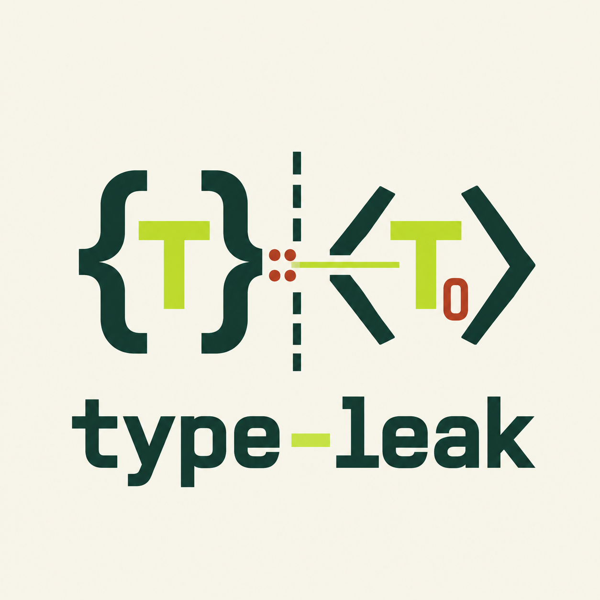

# type-leak crate [![Latest Version]][crates.io] [![Documentation]][docs.rs] [![GitHub Actions]][actions]

[Latest Version]: https://img.shields.io/crates/v/type-leak.svg
[crates.io]: https://crates.io/crates/type-leak
[Documentation]: https://img.shields.io/docsrs/type-leak
[docs.rs]: https://docs.rs/type-leak/latest/type_leak/
[GitHub Actions]: https://github.com/yasuo-ozu/type-leak/actions/workflows/rust.yml/badge.svg
[actions]: https://github.com/yasuo-ozu/type-leak/actions/workflows/rust.yml

<p align="center"></p>

A name in Rust means something only where it is written. When a proc macro copies `fn get(&self) -> MyType` from crate A into code that crate B expands, the copy looks up `MyType` in crate B and finds nothing, or the wrong type.

`type-leak` fixes this for proc-macro authors. In crate A, it finds the types that depend on where they are written, and describes for each a small impl of a shared trait, the *Repeater*, which your macro emits. In crate B, it rewrites the copy so that each such type is written `<Self as Repeater<..>>::Type`.

# How it works

```text
 Crate A (defines the item)                   Crate B (copies the item)
 trait Tr { fn f(&self) -> MyType; }

 1. Analyze the item:                         3. Rewrite the copy:
    Leaker --> Referrer ------ as tokens --->    fn f(&self) -> MyType
                                                 becomes
 2. Emit the Repeater impls:                     fn f(&self) -> <Self as Repeater<..>>::Type
    impl Repeater<..> for .. {                                         |
        type Type = MyType;  <-----------------------------------------+
    }
```

- The **Leaker** analyzes the item. Its result, the **Referrer**, lists the *entries*: the types that depend on where they are written (`MyType`, `Self`, `MyWrap<T>`). It travels to crate B as tokens.
- The **Repeater** is a trait defined once at the root of crate A, not in the proc-macro crate (`repeater_definition()` generates it):

  ```rust,ignore
  pub trait Repeater<T: ?Sized, const KEY: u128, /* one const slot per primitive type */> {
      type Type: ?Sized;
  }
  ```

  `KEY` = `repeater_key(ID, NTH)`: `ID` identifies the analyzed item, `NTH` is the `EntryId` of the entry, and `T` encodes the generics the entry uses.

# Quick start

```rust
use syn::visit_mut::VisitMut;
use syn::{parse_quote, GenericArgument, Ident, ItemImpl, ItemTrait, Path, Signature, Type};
use type_leak::{
    encode_generics_args_with_params, repeater_key, repeater_projection, slot_const, ImplSelf,
    Leaker, UseSite,
};

let item: ItemTrait = parse_quote! {
    pub trait MyLeaker<T> {
        fn f(&self, t: T) -> MyWrap<T>;
        fn g(&self) -> MyType;
    }
};

// Crate A, step 1: analyze the trait.
let mut leaker = Leaker::new();
let top_level = leaker.intern_trait(&item, true);
let result = leaker.result();

// Crate A, step 2: one Repeater impl per entry (`42` is the ID). `ToTokens` writes the impl with
// its `KEY`.
let repeater: Path = parse_quote!(path::Repeater);
let self_param: Ident = parse_quote!(__S);
let impls: Vec<ItemImpl> = result
    .repeater_impls(&repeater, 42, ImplSelf::Param(&self_param), slot_const(&repeater))
    .unwrap()
    .map(|r| parse_quote!(#r))
    .collect();
assert_eq!(impls.len(), 2);
let referrer = result.finish().unwrap();

// Crate B, step 3: rewrite a copy of `f` for `impl MyLeaker<u8> for ..`.
let trait_args: Vec<GenericArgument> = vec![parse_quote!(u8)];
let site = UseSite::substituting(&item.generics.params, &trait_args);
let mut sig: Signature = parse_quote!(fn f(&self, t: T) -> MyWrap<T>);
referrer
    .visitor(top_level, |_ty, ix, context| {
        // The arguments of the Repeater: those of the site for the generics of the entry, encoded.
        let self_ty: Type = parse_quote!(Self);
        let args = site.generic_args(&context.generics).unwrap();
        let args = encode_generics_args_with_params(
            &args,
            &context.generics.params,
            Some((&self_ty, &context.self_outlives)),
            slot_const(&repeater),
        )
        .unwrap();
        repeater_projection(&repeater, &self_ty, &args, 42, ix)
    })
    .visit_signature_mut(&mut sig);
let (ix, _, _) = referrer.iter().next().unwrap();
let key = repeater_key(42, ix);
assert_eq!(
    sig,
    parse_quote!(fn f(&self, t: T) -> <Self as path::Repeater<(u8,), #key>>::Type)
);
assert_eq!(site.substitute(&parse_quote!(T), None), parse_quote!(u8));
```

Only the entries are rewritten: `t: T` is left for you to write, and `site.substitute(&parse_quote!(T), None)` writes `u8`.

If the item has a part that cannot be leaked (`MyType<'_>`), the `Leaker` copies it as written and records an error: `finish()` is then `Err`, and `into_referrer()` is still the `Referrer` of the rest. Report each with `ErrorItem::emit()` (on nightly, a diagnostic with the notes and the help at their own spans), or all with `to_syn_error()`.

In real macros, crate A passes `referrer` and `top_level` to crate B as tokens (`ToTokens` / `Parse`), usually through an exported `macro_rules!`. [`examples/two-macros`](https://github.com/yasuo-ozu/type-leak/tree/main/examples/two-macros) is a complete, tested setup.

# Learn more

- [API docs](https://docs.rs/type-leak/latest/type_leak/). Start with:
  - [`Leaker`](https://docs.rs/type-leak/latest/type_leak/struct.Leaker.html), which analyzes an item: [`intern_trait`](https://docs.rs/type-leak/latest/type_leak/struct.Leaker.html#method.intern_trait) and the other `intern_*` methods for a whole item, [`enter_impl`](https://docs.rs/type-leak/latest/type_leak/struct.Leaker.html#method.enter_impl) and the other `enter_*` methods for parts of one.
  - [`LeakerResult`](https://docs.rs/type-leak/latest/type_leak/struct.LeakerResult.html), what `Leaker::result()` returns: the `Referrer` and the errors, and [`repeater_impls`](https://docs.rs/type-leak/latest/type_leak/struct.LeakerResult.html#method.repeater_impls) in crate A.
  - [`Referrer`](https://docs.rs/type-leak/latest/type_leak/struct.Referrer.html): [`visitor`](https://docs.rs/type-leak/latest/type_leak/struct.Referrer.html#method.visitor) in crate B, with [`encode_generics_args_with_params`](https://docs.rs/type-leak/latest/type_leak/fn.encode_generics_args_with_params.html) for the first argument of the Repeater. An entry is named by its [`EntryId`](https://docs.rs/type-leak/latest/type_leak/struct.EntryId.html).
  - [`repeater_definition`](https://docs.rs/type-leak/latest/type_leak/fn.repeater_definition.html), which generates the Repeater trait, and [`repeater_key`](https://docs.rs/type-leak/latest/type_leak/fn.repeater_key.html), its `KEY`.
  - [`ErrorItem`](https://docs.rs/type-leak/latest/type_leak/struct.ErrorItem.html), the error of the `Leaker`. The `Leaker` [recovers from errors](https://docs.rs/type-leak/latest/type_leak/struct.Leaker.html#errors-and-recovery) and goes on.
- [Limitations of the `Leaker`](https://docs.rs/type-leak/latest/type_leak/struct.Leaker.html#limitations): what cannot be leaked. An error carries a `help` that says what to write instead.
- [`examples/two-macros`](https://github.com/yasuo-ozu/type-leak/tree/main/examples/two-macros): a complete, tested pair of proc macros.
